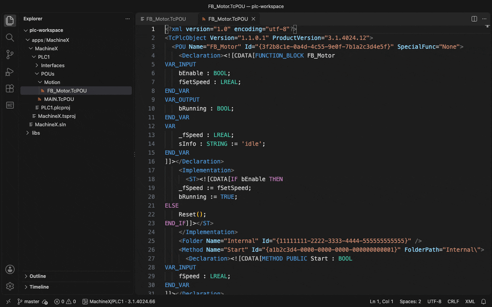
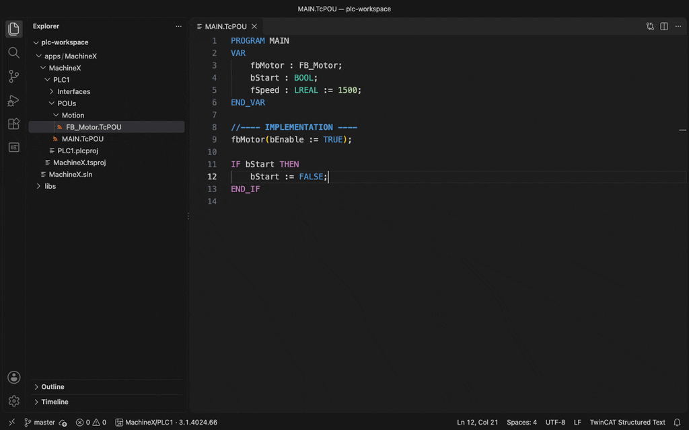
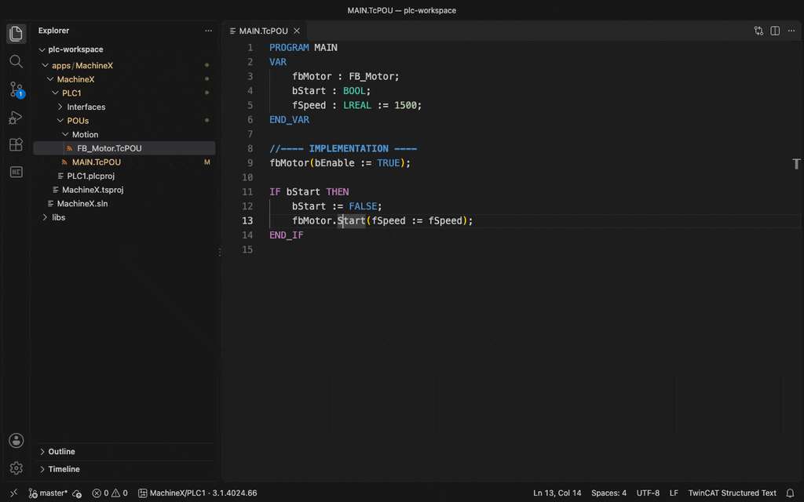

# IECode

[](https://github.com/JanJunklewitz/iecode/actions/workflows/ci.yml)
[](https://github.com/JanJunklewitz/iecode/releases/latest)
[](https://marketplace.visualstudio.com/items?itemName=iecode.iecode)
[](https://github.com/JanJunklewitz/iecode/blob/main/LICENSE)

Structured Text for TwinCAT in VS Code, plus a command-line tool for builds, libraries and deployment.
Open source, built to support other IEC 61131-3 platforms (CODESYS, Siemens) later.



<details>
<summary>More: completion and go to definition, project view and ST diffs</summary>





</details>

| Folder | What it is | Runs on |
|---|---|---|
| [`extension/`](extension/) | VS Code extension: edit `.TcPOU` / `.TcDUT` / `.TcGVL` / `.TcIO` files as plain Structured Text | any OS |
| [`cli/`](cli/) | `iecode` CLI: build, check, activate, libraries, protection, ADS ([commands](cli/README.md)) | Windows with TwinCAT XAE (4024 / 4026); file-based commands on any OS |
| [`packaging/`](packaging/) | `install.ps1` (per-user install from GitHub Releases), NuGet / tcpkg package spec | Windows |
| [`setup-iecode/`](setup-iecode/action.yml) | GitHub Action: `uses: JanJunklewitz/iecode/setup-iecode@v0` | Windows runners |
| [`mockup/`](mockup/index.html) | Clickable mockup of the features | browser |

## Install

### 1. VS Code extension

Search for **IECode** in the Extensions view (VS Code Marketplace / Open VSX) and click **Install**. Versions with
an odd minor number (0.1.x, 0.3.x …) are pre-releases; if VS Code offers it, pick **Switch to Pre-Release Version** on the extension page.

Or install the `.vsix` from [GitHub Releases](https://github.com/JanJunklewitz/iecode/releases):

```powershell
code --install-extension iecode-0.2.1.vsix
```

That's all you need to view, edit and compare TwinCAT files as Structured Text.

### 2. CLI (Windows, for build, activate and libraries)

Easiest: in VS Code run **IECode: Set up this PC** (Command Palette, `Ctrl+Shift+P`). It installs the CLI and checks
your TwinCAT installation.

Or in PowerShell (per user, no admin rights; checks the SHA256 and adds `iecode` to your PATH):

```powershell
irm https://github.com/JanJunklewitz/iecode/releases/latest/download/install.ps1 | iex
iecode doctor
```

Other ways:

| Way | Command | When |
|---|---|---|
| GitHub CLI | `gh release download -R JanJunklewitz/iecode -p "iecode-*-win-x64.zip"`, unzip, add the folder to PATH | you already use `gh` (also works with your GitHub login) |
| ZIP | `iecode-<version>-win-x64.zip` from [Releases](https://github.com/JanJunklewitz/iecode/releases), unzip, add the folder to PATH | offline or locked-down PCs |
| NuGet / TwinCAT Package Manager | `IECode.Cli` from the GitHub Packages feed `https://nuget.pkg.github.com/JanJunklewitz/index.json` | central distribution in a team (the feed needs a GitHub token) |
| GitHub Actions | `uses: JanJunklewitz/iecode/setup-iecode@v0` | CI on Windows runners |

A specific version: `& ([scriptblock]::Create((irm https://github.com/JanJunklewitz/iecode/releases/latest/download/install.ps1))) -Version 0.2.1`.

## Requirements

- The VS Code extension works on its own; no TwinCAT installation is needed to view and edit files.
- The `iecode` CLI needs Windows and a licensed TwinCAT 3 XAE installation (3.1.4024.x or 3.1.4026.x). It uses the
  TwinCAT and Visual Studio components installed on your machine and doesn't ship them.

## Safety

`iecode activate` can change the configuration of, and restart, a real controller. Test on non-production
systems first. The software is provided "AS IS", without warranties of any kind.

## License

[MIT License](LICENSE). See [NOTICE](NOTICE). Contributions require a DCO sign-off, see
[CONTRIBUTING.md](CONTRIBUTING.md). Security issues: [SECURITY.md](SECURITY.md).

## Trademarks

TwinCAT®, Beckhoff® and EtherCAT® are registered trademarks of Beckhoff Automation GmbH. This project is not
affiliated with, endorsed by, or supported by Beckhoff Automation GmbH. The names are used only to describe
compatibility.
