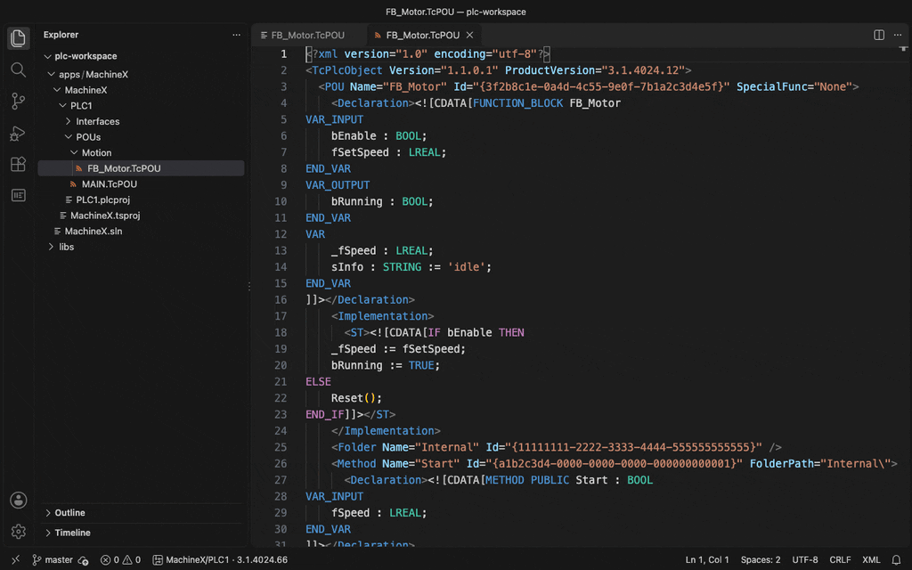
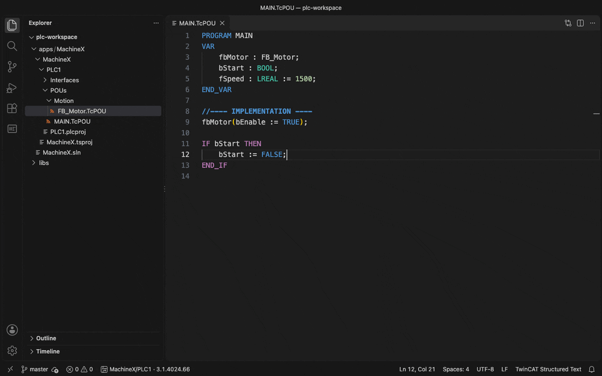
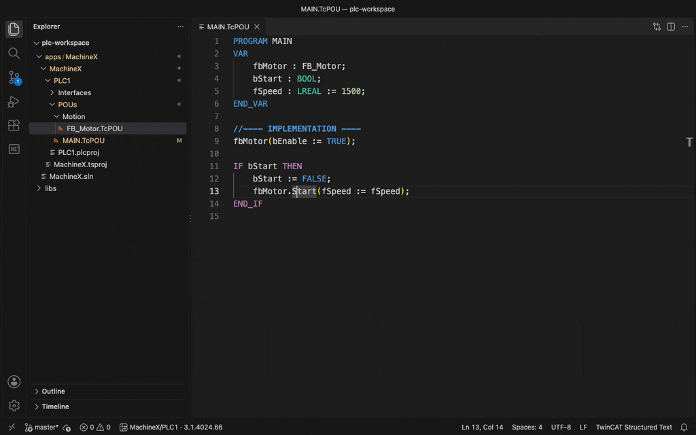
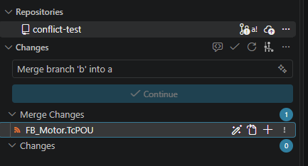
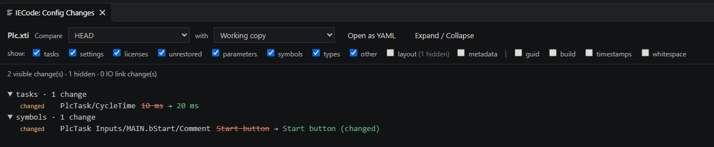

# IECode – Structured Text for TwinCAT

[](https://github.com/JanJunklewitz/iecode/actions/workflows/ci.yml)
[](https://github.com/JanJunklewitz/iecode/releases/latest)
[](https://marketplace.visualstudio.com/items?itemName=iecode.iecode)
[](https://github.com/JanJunklewitz/iecode/blob/main/LICENSE)

Edit TwinCAT 3 `.TcPOU`, `.TcDUT`, `.TcGVL` and `.TcIO` files as plain Structured Text in VS Code, browse and extend
PLC projects, work with several libraries and applications in one workspace, and build / deploy through the
[`iecode` CLI](../cli/README.md).

**No export/import, no `.st` files on disk.** The TwinCAT XML file stays the only source of truth;
VS Code shows a live text view of it and saving writes your text back into the XML file.



Completion after `.`, go to definition across objects, and saving straight back into the `.TcPOU`:



The **IECode** view shows libraries, applications, objects and members; **Compare with HEAD (ST)** diffs the ST, not the XML:



**Merge conflicts** in a `.TcPOU` / `.TcDUT` / `.TcGVL` / `.TcIO` are resolved without touching the XML: the wand in Source Control (or **Auto-resolve XML Conflicts** in the context menu) merges everything outside the ST code, and what is left shows in the ST view as colored blocks with **Accept Current / Incoming / Both Changes**:



**Config Changes** compares a PLC `.xti` by meaning instead of by XML line: old values struck through in red, new values in green, grouped by category, with checkboxes for the noise you do not want to see:



```
FB_Motor.TcPOU (XML on disk)                 Editor (iecode:/…/FB_Motor.TcPOU)
───────────────────────────────              ─────────────────────────────────
<POU Name="FB_Motor" Id="{…}">               FUNCTION_BLOCK FB_Motor
  <Declaration><![CDATA[…]]>       ⇄         VAR_INPUT … END_VAR
  <Implementation><ST><![CDATA[…]]>          //---- IMPLEMENTATION ----
  <Method Name="Start" Id="{…}">             IF bEnable THEN …
    …                                        //==== METHOD Start ====
  <LineIds …>                                METHOD PUBLIC Start : BOOL …
```

## Features

| | Any OS | Windows + TwinCAT XAE + `iecode` CLI |
|---|---|---|
| **Plain-ST editor** for POUs, DUTs, GVLs, interfaces; outline, folding, highlighting, snippets | ✔ | ✔ |
| **IECode view** in the activity bar: Libraries / Applications / Standalone PLC, references, folders, objects, members | ✔ | ✔ |
| **Add** Function Block (EXTENDS, IMPLEMENTS with stubs), Program, Function, Interface, Struct, Enum, Union, Alias, GVL, folder; **add** Method, Property, Action, implement interface; **rename**, **delete** | ✔ | ✔ |
| **Language features**: go to definition, find references, rename symbol, hover, completion after `.`, workspace symbols (Ctrl+T), live checks (unclosed IF/FOR/…, END_VAR, duplicate variables, ARRAY initializers: element count against the bounds, missing / double / trailing commas; hover an element for its index) | ✔ | ✔ |
| **Workspace**: several solutions and loose `.plcproj` files, library links (⇄ workspace / pinned), dependency graph and build order | ✔ | ✔ |
| **Library manager** (Installed / Updates / Consolidate / Browse) on the `.plcproj` files; sources: workspace, TwinCAT library repository, folders | ✔ | ✔ |
| **Library sources**: referenced `.library` files (repository or library folders, and the libraries they reference) are read without TwinCAT: go to definition / find references / hover / completion into library POUs, DUTs, GVLs and interfaces (also `Tc2_Standard.TON`), read-only ST views, objects and members under each reference in the tree | ✔ | ✔ |
| **Build / Check / Clean**, compiler messages in Problems on the ST view lines | – | ✔ |
| **Activate** on local or remote targets, **Save as library** — one or all PLC projects (.library / .compiled-library, install), **Encrypt / protect** with a user DB | – | ✔ |
| **Build workspace** in dependency order, **build affected** projects after saves | – | ✔ |
| **Compare as ST** (no XML): with HEAD, a commit, two commits or another file; Source Control diffs open as ST; **Show ST in git diff** (textconv, `git difftool -t iecode`) | ✔ | ✔ |
| **IO Links**: the PLC / NC / IO links of a TwinCAT project as a hardware tree (device › box › terminal › channel), compared between working copy, HEAD and any commit with added / removed / moved values marked; **Open as YAML** or right-click a `.tsproj` / `.xti` (Explorer, editor tab, Source Control) for a YAML diff in the diff editor; CSV export | ✔ | ✔ |
| **Config Changes**: the changes of a PLC `.xti` (`_Config/PLC/Plc.xti`) between working copy, HEAD and any commit by meaning, grouped by category (tasks, settings, licenses, symbols, types …); checkboxes hide layout, metadata and build / GUID noise and are saved in `iecode.configDiff.hidden`; **Open as YAML**; right-click an `.xti` (Explorer, editor tab, Source Control) | ✔ | ✔ |
| **IO-Link** view: the IO-Link masters of the system projects (EL6224, EP6224 …) with their ports, the device on each port (vendor, device, IDs, IODD) and its process data with the linked variables, also as the **IO-Link Explorer** (tree on the left, details of the selection on the right); **Save as Independent Project File** for one master or **Save All Devices as Independent Project Files**, laid out the way TwinCAT stores them | ✔ | ✔ |
| **ADS Interface**: the symbols ADS clients can access, without a running PLC: from the build output (`<PLC>.tmc`, exact, refreshes after each build) or straight from the source code (working copy or any commit); compare any two or with a saved snapshot / another build's `.tmc`, CSV export, JSON snapshot for `iecode ads diff` | ✔ | ✔ |
| **Visualization editor** for `.TcVIS`: the elements drawn on a canvas with the content of frames and tab controls from the workspace; move / resize with the mouse or arrow keys; edit texts, variables, frame parameters, input actions and colors in a property panel, and the visualization's size and background; **Simplified** view lists what each element shows and does; wireframe drawing; **YAML** summary, also used to compare visualizations (HEAD, commits, Source Control, `git diff`) | ✔ | ✔ |
| **Text lists, image pools, visualization manager** (`.TcGTLO`, `.TcIPO`, `.TcVMO`): translations as an editable table, images with previews, the visualization manager's settings as a form; compared as YAML | ✔ | ✔ |
| **Project settings** of a PLC project (right-click it in the IECode view or a `.plcproj` in the Explorer): title, company, version, released, default namespace, placeholder, author, description, compiler defines; keeps `Global_Version.TcGVL` in step with title and version | ✔ | ✔ |
| **AI chat context**: right-click code in the ST view or an element in the visualization editor → **Add to AI Chat** / **Comment for AI…**, or drag an element from the element list into the chat; goes to Claude Code or GitHub Copilot Chat (`iecode.aiChat`) | ✔ | ✔ |
| **ADS Watch** view: live values of PLC variables on the local runtime or a remote target (`iecode.ads.target`); add them from the build output (`.tmc`), by name or by right-clicking a variable in the ST editor; **write** a value (always confirmed, also on `local`) or copy it. The **scope** (graph icon in the view title) plots the numeric variables live: time span 10 s to 5 min, pause, per-variable show/hide, cursor readout. Connects only while the view shows variables and disconnects 30 s after it is hidden | – | ✔ |
| **AI tools for live values** (GitHub Copilot Chat in agent mode, VS Code 1.99 or later; the extension itself needs 1.95): `#adsSymbols` finds ADS names in the build output, `#adsWatch` adds or removes watched variables (entries the AI added show a sparkle icon, and the AI can only remove those), `#adsRead` reads current values, `#adsScope` summarizes the last seconds (min / max / last and a table), `#adsWrite` writes a value per `iecode.ads.aiWrites`: **off** by default, **confirm** each write, or **auto**-approve (the view then shows *AI writes: auto*); set it with **Set AI Write Access…** in the view's `…` menu. Every AI write is logged in the IECode output. **Add to AI Chat** in the same menu sends the last 60 s of all watched variables to the chat (`iecode.aiChat`); that is also the way for Claude Code, which cannot call VS Code's AI tools | – | ✔ |
| Encrypted objects are shown with a lock and can't be opened as text | ✔ | ✔ |

## Settings

| Setting | Default | |
|---|---|---|
| `iecode.openAsST` | `true` | Open TwinCAT object files as Structured Text instead of XML |
| `iecode.greenComments` | `true` | Show ST comments green, also in themes that render them grey (not in high contrast themes) |
| `iecode.cliPath` | `""` | Path to `iecode`; empty: from PATH. Install with **IECode: Set up this PC** (installs and checks TwinCAT) or **IECode: Install CLI** |
| `iecode.tcVersion` | `auto` | TwinCAT version for build / activate: `auto`, `4024`, `4026`, `4024.66` |
| `iecode.platforms` | `[]` | Target platforms to build, e.g. `TwinCAT RT (x64)` |
| `iecode.targets` | `[]` | AMS NetIds offered when activating |
| `iecode.restartAfterActivate` | `true` | Restart TwinCAT in run mode after activating |
| `iecode.libraryOutput` | `dist` | Folder (relative to the solution) for saved libraries |
| `iecode.libraryRepository` | `""` | Library repository; empty: `%TWINCAT3DIR%\Components\Plc\Managed Libraries` |
| `iecode.librarySources` | `[]` | Extra folders with `<Name>_<Version>.library` files |
| `iecode.showXae` | `false` | Show the XAE window while the CLI works |
| `iecode.ads.target` | `local` | Target of the ADS Watch view: `local` or an AMS NetId |
| `iecode.ads.port` | `851` | ADS port of the PLC runtime |
| `iecode.ads.sampleIntervalMs` | `100` | How often watched values are read (10 … 5000 ms; below ~16 ms Windows timers make it slower) |
| `iecode.ads.bufferSeconds` | `300` | Seconds of values kept for the scope and AI tools (10 … 3600) |
| `iecode.ads.aiWrites` | `off` | Whether AI tools may write PLC variables: `off`, `confirm` (each write), `auto` (no IECode prompt; asks anyway while the workspace settings change `iecode.ads.target` or `iecode.ads.port`). User settings only, so a workspace cannot turn it on |

## How it works

- A `FileSystemProvider` for the `iecode:` scheme. `readFile` decodes the XML into one ST document,
  and `writeFile` reads the current XML from disk and **splices only the CDATA blocks that changed**.
- A save with no changes leaves the file byte-identical. GUIDs, `FolderPath`, attributes, CRLF line endings, BOM and
  non-ST bodies (CFC/LD/SFC, shown as read-only markers) are all kept.
- If you change a method's code, the extension removes its `<LineIds>` entry, which is stale at that point; TwinCAT rebuilds it.
- Adding a `//==== METHOD X ====` section creates a new `<Method>` with a fresh GUID, and deleting one removes it.
- Invalid views (e.g. a `GET` without a `PROPERTY`) are refused at save time with a line number. The editor stays dirty
  and the file isn't touched.
- When TwinCAT XAE changes the file on disk, the view reloads.

Visualizations (`.TcVIS`) store each element as a list of `{ Id, Value }` pairs, where the id is the CRC-32 of the
property's path in the element's function block (`m_StaticPosition.iX`, `m_StaticTexts.pstText`, …). The editor
decodes the common properties by that hash and frame parameters by the name tree stored next to them; other values
appear as `#<id>` under **All properties**. Edits replace single values in place (undo / redo / save as for text),
so the rest of the file stays byte-identical. Values that are style colors, structured, or missing in an element are
read-only there: set them once in TwinCAT.


The ST view is also available on the command line (`node out/src/cli.js`, installed as `iecode-st`):

```
iecode-st decode <file>                                  # ST view (.TcVIS: YAML summary)
iecode-st diff <a.TcPOU> <b.TcPOU>                       # unified diff of the ST views
iecode-st diff --rev HEAD~3 [--to <ref>] <file>          # ST diff against git history
iecode-st links <x.tsproj> [--csv|--yaml]                # IO links (--yaml: hardware tree)
iecode-st links-diff --rev <ref> [--to <ref>] <x.tsproj> # IO link changes
iecode-st config-diff --rev <ref> [--to <ref>] <file.xti> [--all] [--hide <ids>]  # config changes of an xti
iecode-st ads <x.plcproj|x.tmc> [--rev <ref>] [--members]  # ADS interface from source / build output
iecode-st ads-diff --rev <ref> [--to <ref>] <x.plcproj>     # ADS interface changes in the source
```

As a git textconv for readable diffs (or use **IECode: Show ST in git diff**):

```
git config diff.iecode.textconv "node /path/to/out/src/cli.js decode"
echo "*.TcPOU diff=iecode" >> .gitattributes
echo "*.TcVIS diff=iecode" >> .gitattributes
```

## Develop

```
npm install && npm test          # unit tests (view round trip, project model, templates, workspace, language, libraries, visualizations)
IECODE_TCVIS_SAMPLES=<folder> npm test   # also parse every .TcVIS below <folder> (real projects, nothing is written)
./scripts/e2e.sh                 # end-to-end in real VS Code (throwaway profile)
npm run package                  # iecode-<version>.vsix
```

Or open this folder in VS Code and press F5.

## Known limits

- Section order in the text doesn't reorder XML elements. A renamed section header counts as delete + add, so the member gets a new GUID.
- Renaming an object in the tree renames the file, its declaration and the `.plcproj` entry, but not references to it in other objects (use **Rename Symbol** for variables and members).
- Name resolution covers locals, members, EXTENDS, qualified names, arrays, pointers, GVLs and enums of the workspace and of referenced libraries with sources (`.library`). A `.compiled-library` (e.g. most Beckhoff libraries) has no sources: its symbols are not known. Of a library, the version TwinCAT would use is read (`*`: the newest available).
- Compiler messages are mapped to the ST view by object name; for errors in declarations the line may be off.
- The ADS interface from source code has no sizes and ignores conditional pragmas. It doesn't know types from libraries: library GVLs (e.g. each library's `Global_Version`) and members inherited from library function blocks are missing. The build output (`.tmc`) is exact.
- Visualization editor: elements can't be added or deleted yet, and the drawing is an approximation (no images, styles
  as their stored colors, frames from libraries as placeholders). Texts containing `"` can't be edited there.
- **Save as Independent Project File** edits the `.xti` files directly: close the project in TwinCAT XAE first, or XAE overwrites the change when it saves. Only EtherCAT boxes stored in an `.xti` (not inline in the `.tsproj`) can be moved.
- The CLI-driven features have not been tested against a real TwinCAT installation yet.
- AI writes with `iecode.ads.aiWrites` = `confirm` rely on you not choosing **Always Allow** for the `adsWrite` tool in the chat: VS Code then skips the confirmation, and the extension API (1.95) offers no way to keep a tool from being auto-approved. With `auto` IECode asks nothing, but VS Code may still show its own confirmation by its tool approval rules. `iecode.ads.target` and `iecode.ads.port` can come from a workspace `.vscode/settings.json`; while they differ from your user settings, `auto` confirms each write (the prompt shows the target), so a cloned repository cannot choose where auto-approved writes go.

## License and trademarks

MIT License, see [LICENSE](LICENSE) and [NOTICE](NOTICE).

TwinCAT®, Beckhoff® and EtherCAT® are registered trademarks of Beckhoff Automation GmbH. This extension is not
affiliated with, endorsed by, or supported by Beckhoff Automation GmbH.
